  
  
  
  
  

  <a href="#tentang-saya">Tentang</a> ·
  <a href="#keahlian-teknis">Keahlian</a> ·
  <a href="#perjalanan-belajar">Belajar</a> ·
  <a href="#proyek-unggulan">Proyek</a> ·
  <a href="#statistik-github">Statistik</a> ·
  <a href="#hubungi-saya">Kontak</a>

 

## Tentang Saya

Saya mahasiswa **Sains Data** yang sedang membangun fondasi di analisis data, statistika, dan machine learning, sambil melatih kemampuan rekayasa perangkat lunak lewat proyek langsung.

- **Fokus:** Python untuk analisis data, SQL, pola pikir statistik, dan visualisasi data
- **Minat:** Data Science, Artificial Intelligence, Machine Learning, Statistika, Software Engineering
- **Tujuan:** Beranjak dari tugas kuliah dan latihan terbimbing menuju proyek data end-to-end yang bisa saya publikasikan dan jelaskan
- **Cara kerja:** Belajar secara terbuka, mendokumentasikan hasil, dan memperbaiki diri sedikit demi sedikit
- **Keyakinan:** Setiap dataset punya cerita yang layak diceritakan

 

 

## Ringkasan

| Bidang | Keterangan |
| :-- | :-- |
| **Nama** | Faiq Atha Rulloh |
| **Peran** | Mahasiswa Sains Data |
| **Bahasa utama** | Python, SQL, R (sedang dipelajari), serta Java, TypeScript, Dart, dan PHP dari tugas kuliah dan proyek |
| **Sedang didalami** | Alur kerja analisis data, visualisasi, dan dasar-dasar statistika |
| **Target berikutnya** | Proyek Data Science pertama yang dipublikasikan beserta Jupyter Notebook |
| **Terbuka untuk** | Belajar bersama, bimbingan, dan kolaborasi |

 

## Keahlian Teknis

  
  
  

| Kategori | Teknologi |
| :-- | :-- |
| **Bahasa Pemrograman** |     |
| **Analisis Data** |   |
| **Visualisasi Data** |   |
| **Basis Data** |  |
| **Alat Pengembangan** |    |
| **Pengembangan Web dan Aplikasi** |     |

> Teknologi Machine Learning dan AI sengaja belum dicantumkan. Pustaka seperti scikit-learn akan saya tambahkan setelah muncul di proyek yang saya publikasikan.

 

## Perjalanan Belajar

| Bidang | Status | Yang sedang dikerjakan |
| :-- | :-- | :-- |
| Python untuk Analisis Data | Sedang berjalan | Pembersihan dan eksplorasi data dengan Pandas dan NumPy |
| Visualisasi Data | Sedang berjalan | Menyampaikan temuan dengan Matplotlib dan Plotly |
| SQL dan Basis Data | Sedang berjalan | Query dan pemodelan data relasional dengan MySQL |
| Statistika | Sedang berjalan | Statistika deskriptif dan dasar-dasar inferensi |
| Machine Learning | Berikutnya | Konsep supervised learning dan evaluasi model |
| Rekayasa Perangkat Lunak | Aktif | Proyek full-stack dan mobile, version control dengan Git |

### Peta Jalan

```mermaid
flowchart LR
    A["Dasar Python dan SQL"] --> B["Pembersihan data dan EDA"]
    B --> C["Visualisasi dan storytelling"]
    C --> D["Statistika dan inferensi"]
    D --> E["Dasar Machine Learning"]
    E --> F["Proyek portofolio end-to-end"]
    style A fill:#6366F1,color:#fff,stroke:#818CF8
    style B fill:#6366F1,color:#fff,stroke:#818CF8
    style C fill:#6366F1,color:#fff,stroke:#818CF8
    style D fill:#1E1B4B,color:#C7D2FE,stroke:#6366F1
    style E fill:#1E1B4B,color:#C7D2FE,stroke:#6366F1
    style F fill:#1E1B4B,color:#C7D2FE,stroke:#6366F1
```

Kotak berwarna penuh adalah tahap yang sedang saya jalani. Kotak gelap adalah tahap selanjutnya.

 

## Proyek Unggulan

<table>
  <tr>
    <td width="50%" valign="top" align="center">
      
        
      
      
    </td>
    <td width="50%" valign="top" align="center">
      
        
      
      
    </td>
  </tr>
  <tr>
    <td valign="top">
      <b>E-Commerce E-Book dan SPK (SAW)</b> 
      Aplikasi e-commerce e-book <i>single-seller</i> (B2C) dengan rencana integrasi Sistem Pendukung Keputusan metode Simple Additive Weighting di backend. Dikelola sebagai monorepo dengan dokumentasi arsitektur, API, keamanan, dan keputusan teknis (ADR).
        
      
      
      
      
      
      
        
      <b>Dipelajari:</b> arsitektur monorepo, validasi input dengan Zod, pemodelan basis data relasional, keamanan akses file, dasar pengambilan keputusan multi-kriteria.
        
      <a href="https://github.com/Faiq-DataSci/ebook-ecommerce"><b>Lihat repositori &rarr;</b></a>
    </td>
    <td valign="top">
      <b>Situs Informasi Pariwisata</b> 
      Situs informasi pariwisata berbasis PHP, HTML, dan CSS. Proyek ini melatih dasar pengembangan web sisi server dan tata letak antarmuka.
        
      
      
      
        
      <a href="https://github.com/Faiq-DataSci/website-pariwisata"><b>Lihat repositori &rarr;</b></a>
    </td>
  </tr>
</table>

<b>Status pengembangan ebook-ecommerce</b>

 

| Komponen | Teknologi | Status |
| :-- | :-- | :-- |
| Backend API | Express 5, TypeScript, Zod, Prisma 7 | Fondasi tersedia: autentikasi Supabase, otorisasi peran, rate limiting, skema database awal |
| Web Admin | React, TypeScript, Vite | Kerangka aplikasi |
| Web Pengunjung | React, Vite | Kerangka aplikasi |
| Mobile | Flutter, Dart, Riverpod, Dio | Kerangka aplikasi |
| SPK SAW | Perhitungan di backend | Direncanakan |
| Pembayaran dan akses e-book | Payment gateway, signed URL | Direncanakan |

### Repositori Tugas Kuliah

| Repositori | Mata kuliah | Bahasa |
| :-- | :-- | :-- |
| [os-202501-250320571](https://github.com/Faiq-DataSci/os-202501-250320571) | Praktikum Sistem Operasi | Python |
| [oop-202601-250320571](https://github.com/Faiq-DataSci/oop-202601-250320571) | Pemrograman Berorientasi Objek | Java |

> **Segera hadir:** proyek Data Science dan Machine Learning akan ditambahkan di sini setelah dipublikasikan.

 

## Statistik GitHub

<table>
  <tr>
    <td align="center" colspan="2"><b>Ringkasan Aktivitas</b></td>
  </tr>
  <tr>
    <td align="center"></td>
    <td align="center"></td>
  </tr>
  <tr>
    <td align="center" colspan="2"><b>Profil dan Pola Kerja</b></td>
  </tr>
  <tr>
    <td align="center"></td>
    <td align="center"></td>
  </tr>
  <tr>
    <td align="center" colspan="2"><b>Bahasa Pemrograman</b></td>
  </tr>
  <tr>
    <td align="center"></td>
    <td align="center">
      
      
    </td>
  </tr>
</table>

Data diambil langsung dari GitHub dan diperbarui otomatis oleh layanan pihak ketiga. Bahasa terbanyak mencerminkan proyek web dan mobile, sedangkan proyek Data Science akan menyusul.

 

## Hubungi Saya

 

Terus belajar. Terima kasih sudah berkunjung.

